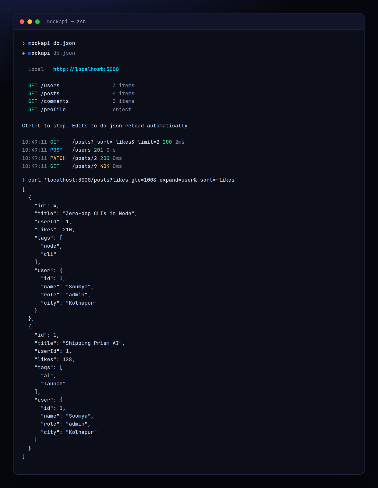

<!-- ═════════════ HEADER ═════════════ -->
<p align="center">
  
</p>

<p align="center">
  
</p>

<p align="center">
  <a href="https://github.com/krishyaa06/prism-mock-api/actions/workflows/ci.yml"></a>
  
  
  <a href="LICENSE"></a>
</p>

<p align="center">
  
</p>


## ⚡ Overview

**Prism Mock API** (`mockapi`) gives your frontend a real backend before the backend exists. Write a `db.json` (or let it create a sample one), run `mockapi` and every top-level array becomes a REST collection with full CRUD, every object becomes a singleton endpoint. Writes are saved back to the file, edits to the file hot-reload, and you get filters, search, sorting, pagination and relations — perfect for prototypes, demos, hackathons and AI-generated frontends.

## ✨ Features

- **CRUD** for every collection: `GET/POST /posts`, `GET/PUT/PATCH/DELETE /posts/:id`
- **Filters**: `?role=dev`, `?likes_gte=100`, `_lte/_gt/_lt/_ne`, regex `?title_like=ai`, full-text `?q=`
- **Sort & paginate**: `?_sort=-likes`, `_page/_limit` with `X-Total-Count` and `Link` headers, `_start/_end`
- **Relations**: `?_embed=comments`, `?_expand=user`, nested `/posts/1/comments`
- **Singletons**: objects like `profile` support GET / PUT / PATCH
- `--delay` to simulate slow networks, `--read-only`, `--prefix /api`, `--no-persist`
- CORS on, colourful request log, auto free port, LAN URL, hot reload; zero dependencies

## 🚀 Quick Start

```bash
# run without installing
npx github:krishyaa06/prism-mock-api 

# or install globally
npm install -g github:krishyaa06/prism-mock-api
mockapi db.json --delay 300
```

Requires Node.js 18.17+. No dependencies.

## 🛠️ Usage

```text
mockapi [db.json] [options]       (creates db.json with sample data if missing)

  -p, --port <n>        port (default 3000, next free if busy)
  -d, --delay <ms>      add latency to every response
      --prefix <path>   mount under a path, e.g. /api
      --read-only       reject writes
      --no-persist      keep writes in memory only
      --no-watch        don't reload when the file changes
  -q, --quiet           no request log
```

### Routes

| Request | Result |
| --- | --- |
| `GET /posts?likes_gte=100&_sort=-likes` | filtered + sorted list |
| `GET /posts?_page=2&_limit=10` | page 2, `X-Total-Count` header |
| `GET /posts/1?_embed=comments` / `?_expand=user` | with relations (`postId`, `userId`) |
| `GET /posts/1/comments` | nested children |
| `POST /posts` | create, auto id |
| `PUT` / `PATCH` / `DELETE /posts/1` | replace / merge / remove |
| `GET /` | list of resources |

```js
// in your frontend
const posts = await fetch("http://localhost:3000/posts?_sort=-likes").then(r => r.json());
```

## 📁 Project Structure

```text
prism-mock-api/
├── assets/
│   ├── logo.png
│   └── logo.svg
├── bin/
│   └── mockapi.js   # CLI entry
├── examples/
│   └── db.json   # sample database
├── src/
│   ├── index.js   # router, query engine, persistence
│   └── ui.js   # colours, tables
├── test/
│   └── mockapi.test.js
├── .gitignore
├── LICENSE
└── package.json
```

## 🧪 Tests

```bash
npm test
```

Tests use the built-in `node:test` runner, so there is nothing to install. CI runs them on Node 20 and 22.

## 🤝 Contributing

1. Fork the repo and create a branch: `git checkout -b feature/my-idea`
2. Make your change and add a test in `test/`
3. Run `npm test` and open a Pull Request

## 🔷 Part of Prism Protocol

Prism Mock API is one of the open-source tools built by [Prism Protocol](https://dc.gg/prismprotocol), a tech community where young builders learn, ship and compete together.

## 👤 Author

<table>
  <tr>
    <td align="center">
      <a href="https://github.com/krishyaa06"><br><b>Soumya Bhandare</b></a><br>
      <sub>Founder @ Prism Protocol</sub>
    </td>
    <td>
      <a href="https://dc.gg/prismprotocol"></a><br>
      <a href="https://instagram.com/prism_protocol_"></a><br>
      <a href="https://x.com/krishyaa06"></a>
    </td>
  </tr>
</table>

## 📄 License

Released under the [MIT License](LICENSE).

<p align="center">
  <b>If you like this project, consider giving it a ⭐</b><br>
  <sub>"Build. Create. Compete." · Made with ⚡ by Prism Protocol</sub>
</p>


